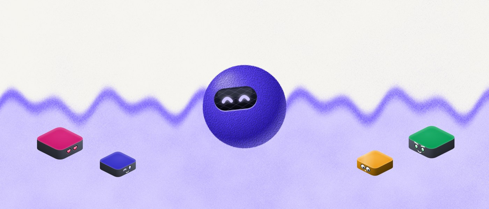
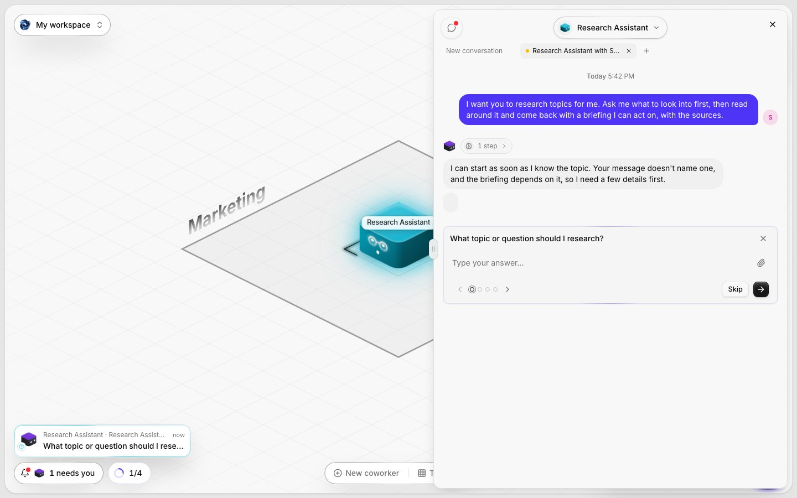
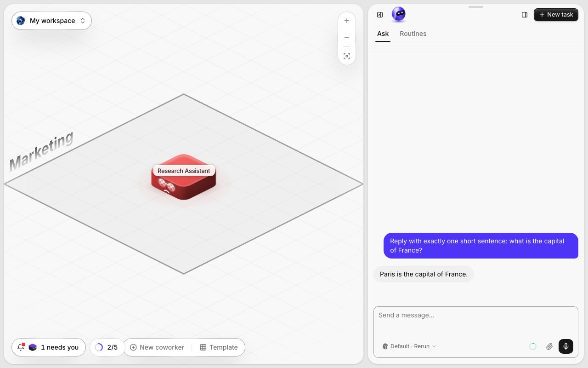
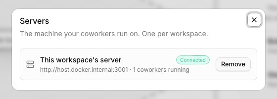

<p align="center">
  <picture>
    <source media="(prefers-color-scheme: dark)" srcset=".github/assets/banner-night.jpg">
    
  </picture>
</p>

<h1 align="center">Rerun</h1>

<p align="center">
  <strong>AI coworkers for your team. They use your tools, work on a schedule, and check with you before anything that matters.</strong>
</p>

<p align="center">
  <a href="LICENSE"></a>
  <a href="https://github.com/rerun-build/rerun/actions/workflows/ci.yml"></a>
  <a href="https://github.com/rerun-build/rerun/releases"></a>
</p>

<p align="center">
  <a href="https://docs.rerun.build">Docs</a> ·
  <a href="https://rerun.build">Rerun Cloud</a> ·
  <a href="CONTRIBUTING.md">Contributing</a>
</p>

---

You tell Rerun what you need done, in plain words. Its guide, the Foreman, sets up a team of
coworkers for it: one answers your inbox, one writes your weekly report, one watches your
competitors. Each one has its own memory, its own skills and its own computer. You see them all on
one board, you talk to any of them like to a colleague, and they ask before they send, pay or
delete anything.

This repository is Rerun, the same product Rerun Cloud runs, for you to host.

<p align="center">
  
</p>
<p align="center">
  
  
</p>

## Quick start

You need Docker, and a Supabase project (a free one on [supabase.com](https://supabase.com) works).

```bash
git clone https://github.com/rerun-build/rerun.git && cd rerun
cp .env.example .env          # fill the Supabase URL and keys, and an OpenRouter key
node scripts/self-host-check.mjs
npx supabase link --project-ref <your-project-ref> && npx supabase db push --include-seed
docker compose up -d --build  # then open http://localhost:3000
```

The [self-hosting guide](https://docs.rerun.build/self-host) walks through every step, including
Supabase on your own machine, adding servers, HTTPS and updates.

## What you get

- **Coworkers** with a soul, skills, a memory that grows, schedules and webhook triggers
- **The Foreman**, who interviews you, plans a team and builds it
- **A board** where every coworker, every Box and every running task is in sight
- **Chat** with any coworker, with files, voice notes, tables and approvals inline
- **Their own computer**: a browser and a screen you can watch, and take over
- **The services catalog**: 200+ ready integrations, any MCP server, and 2,000+ apps through Composio
- **Your models**: an Anthropic, OpenAI, Gemini or OpenRouter key, or your Claude or ChatGPT subscription
- **No limits** on coworkers or seats, and nothing to pay

## Rerun open source and Rerun Cloud

Rerun Cloud is this same Rerun, hosted, plus what only a hosted service can offer.

| | Open source | Rerun Cloud |
|---|---|---|
| Coworkers, chat, memory, skills, schedules | ✅ | ✅ |
| Services catalog, MCP, Composio | ✅ | ✅ |
| Templates | Coming soon | ✅ |
| A computer for each workspace | You host it, one command attaches it | Ready in 30 seconds |
| AI models | Your keys or subscriptions | Included credit, or your keys |
| LinkedIn Pro, WhatsApp Pro | | ✅ |
| Paid data (leads, SEO, social) | | ✅ |
| Email notifications and invitations | | ✅ |
| Updates | Each release | Continuous |
| Support | Community | ✅ |

## How it fits together

```
 browser ──▶ app (Next.js, apps/ui) ──▶ Supabase (Postgres, auth, storage, realtime)
                    │      ▲
                    ▼      │
             engine (apps/engine): one per workspace, runs the coworkers,
             their files, their browser and their screen, on your machine
```

## Contributing

Bug reports, fixes and docs are welcome. Read [CONTRIBUTING.md](CONTRIBUTING.md) first: it explains
how to run Rerun from source and how pull requests flow back into Rerun Cloud.

Self-hosting is documented, not supported: an issue without logs or steps to reproduce is closed
with a link to the guide.

## License

[AGPL-3.0](LICENSE). You can run, modify and host Rerun freely; if you host it for others, you
publish your changes under the same license. The name and logo are not covered: see
[TRADEMARK.md](TRADEMARK.md).
